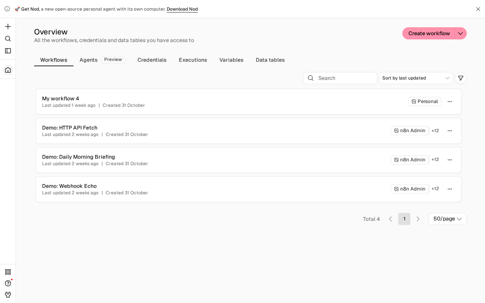
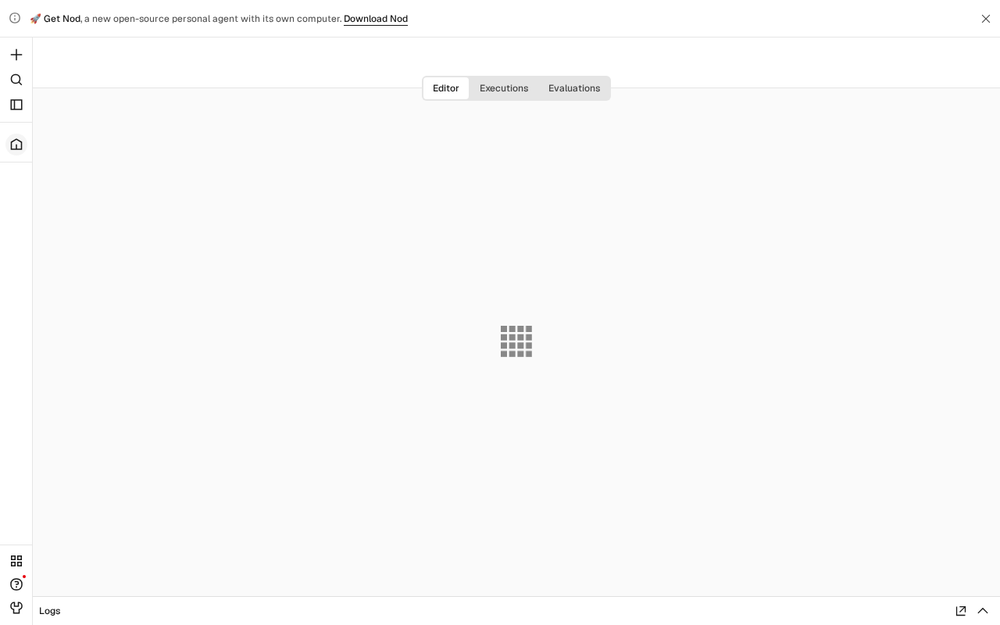

# Automation with n8n

[n8n](https://n8n.openedusuite.org) connects the services of the
openEduSuite: when something happens in one place, n8n can react in
another — send a message, write a file, create a ticket, fetch data.
You assemble these automations visually from building blocks.

## The Overview

After signing in you see your **Workflows**: the automations of your
account, with ready-made demo workflows to learn from. The sidebar
leads to the important places:

- **Overview** — your workflows, executions, and credentials at a
  glance
- **Create workflow** — start a new automation
- **Credentials** — the accounts and keys your workflows use
- **Executions** — what ran, when, and with what result
- **Data tables** and **Variables** — storage and values for your
  automations

## Looking Inside: the Editor

Open a demo workflow to see how an automation is built: the editor
shows the flow as connected nodes on a canvas — each node is one step,
the lines show where the data flows. Tabs above the canvas lead to
**Executions** (what ran, with what result) and further views of the
workflow.

## Building a First Automation

1. Choose **Create workflow** — the editor opens with a start point
2. Pick a **trigger**: what starts the automation — for example a
   schedule, a webhook, or an event in a service
3. Add steps: each step does one thing — fetch, transform, send
4. Test the steps as you build, then activate the workflow

Good first automations are small: one trigger, one or two steps. The
demo workflows show complete examples you can copy and adapt. If
something refuses to work, the [helpdesk](/suite/helpdesk-create-ticket)
is the place to ask.

## Accessibility

| Action | Key |
|--------|-----|
| Move through lists and dialogs | `Tab` |
| Open the focused element | `Enter` |

- The overview and dialogs are ordinary web elements: `Tab` moves you
  through them, `Enter` opens the focused element.
- If you lose your orientation, press `Ctrl+Home` (German keyboards:
  `Strg+Pos1`) to return to the top of the page.
