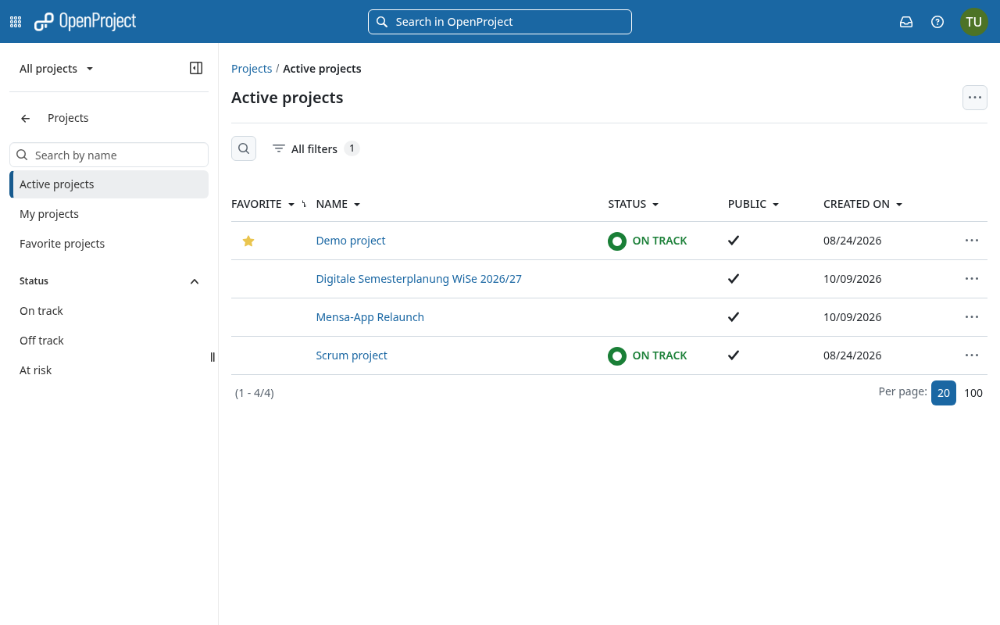
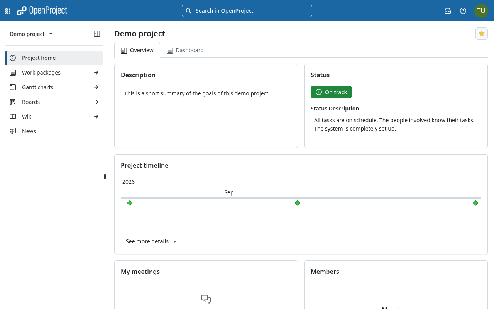

# Projects and Tasks (OpenProject)

[OpenProject](https://openproject.openedusuite.org) is the workspace for
organized teamwork: projects with their statuses, work packages, and
timelines. Where the [chat](/suite/chat) is for talking and the
[wiki](/suite/xwiki) for knowledge, OpenProject is where the *plan*
lives — who does what, by when, and how far along it is.

## The Overview

After signing in with your openEduSuite account, the navigation leads
to everything: **Home**, **All projects**, **My page**, and the
working areas — **Projects**, **Work packages**, **Gantt charts**,
**Boards**, **News**, and **Wiki**.

**All projects** shows the table with favorites, names, and a status
per project — *On track*, *Off track*, or *At risk* — so you can spot
at a glance where things stand.

## Inside a Project

Open a project and its overview greets you: the **Description** with
its goals, the current **Status** with a note explaining it, and the
**project timeline** — milestones on a time axis (for example *Start
of project*, *Conference*, *End of project*), so the arc of the
project is visible without reading a single work package.

The **Dashboard** tab beside it collects the project's numbers;
**News** carries announcements from the project's people.

## Working With Work Packages

A work package is one piece of the project — a task, a milestone, a
phase. Find them under **Work packages** (or a project's own list):
each has a type, a status, someone responsible, and dates. Boards show
the same work as columns to drag along — from *open* to *done* — for
teams that prefer seeing progress over lists.

New to a project? Start at its overview, then read the work packages
assigned to you — yours carry your name. Questions about a task belong
in its comments or in the [chat](/suite/chat).

## Accessibility

| Action | Key |
|--------|-----|
| Move through navigation, tables, and projects | `Tab` |
| Open the focused link or project | `Enter` |

- The pages are ordinary web elements: `Tab` moves you through the
  navigation, the project table, and work packages, `Enter` opens the
  focused entry.
- Tables announce their columns and rows in the standard way; if you
  lose your orientation, `Ctrl+Home` (German keyboards: `Strg+Pos1`)
  returns you to the top of the page.
