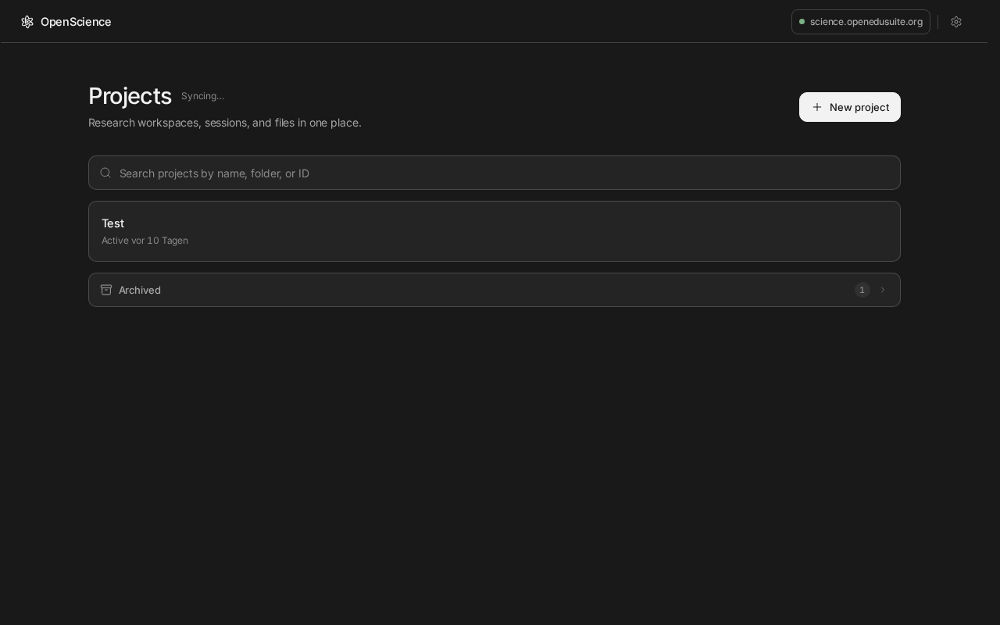

# Research (OpenScience)

[OpenScience](https://science.openedusuite.org) bundles research
work in one surface: **Projects**, workspaces, compute sessions,
and files in one place. Reach it through the portal tile
**Research (OpenScience)** and sign in with SSO.

- **Projects** — your research projects; each project keeps its
  files and sessions together. **New project** starts another one.
- **Workspaces & sessions** — places to compute: start a session,
  work inside it, end it. Whatever you produce in a session stays
  with the project.
- **Files** — the project's files, across all its sessions.

## OpenScience and Its Neighbors

- **[EWOKS](/suite/ewoks)** — reproducible multi-step processing
  as a workflow; OpenScience provides the workspaces where such
  analyses run.
- **[Nextcloud](/suite/nextcloud)** and
  **[OpenCloud](/suite/files)** — plain file storage without
  compute sessions.
- The portal marks the service as beta — if something misbehaves,
  the [helpdesk](/suite/helpdesk-create-ticket) wants to know.

## Accessibility

| Action | Key |
|--------|-----|
| Move through projects, buttons, and menus | `Tab` |
| Open the focused element | `Enter` |

- The projects overview is an ordinary list with buttons — `Tab`
  walks it in order.
- `Ctrl+Home` (German keyboards: `Strg+Pos1`) returns you to the
  top of the page.
