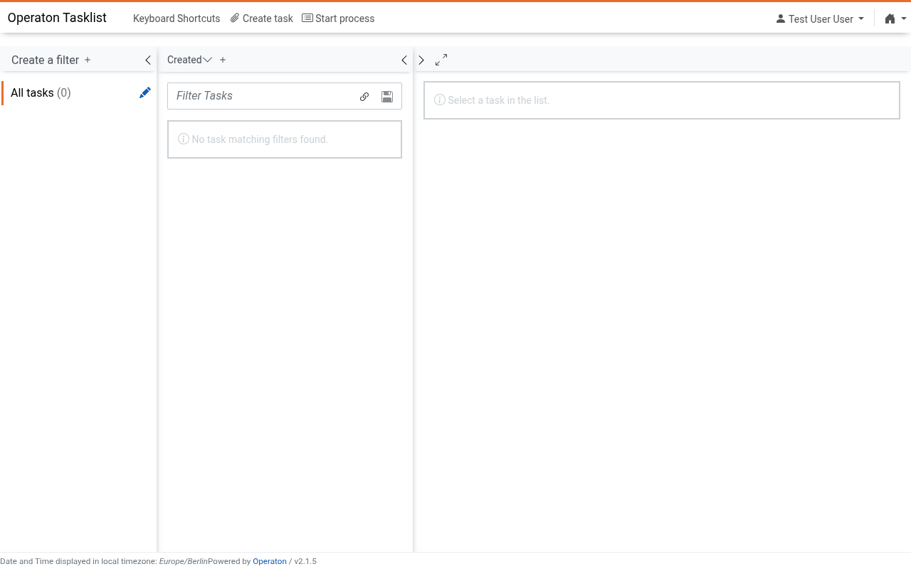
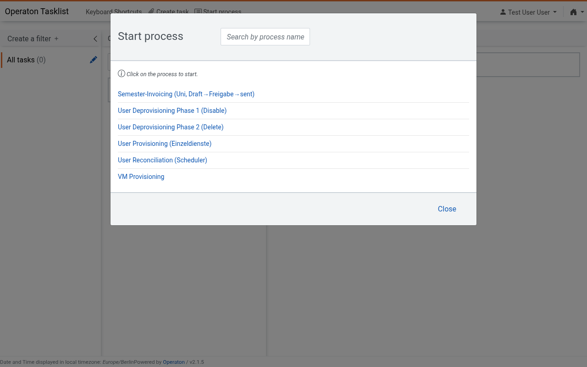

# Processes and Tasks (Operaton)

[Operaton](https://operaton.openedusuite.org) is the workflow engine of
the openEduSuite: administrative and collaborative processes run here
digitally — approvals, applications, checklists. You meet it when a
process assigns you a task.

## Your Tasks

After signing in from the [portal](/suite/portal), open the **Tasklist**. It shows the tasks assigned to
you, for example under **All tasks**. Open a task to see its form:
details, fields to fill in, and a button to complete the step —
sometimes a choice between several paths. What you see
exactly depends on the process.

Some lists keep a filter so you see only what matters to you; the
number next to a list entry shows how many tasks it currently holds. With no tasks waiting, the
list says so plainly ("No task matching filters found.") — then there
is simply nothing for you to do.

## Starting a Process

Many processes can also be started by you directly: choose **Start process**
— a panel opens with the processes your university has
deployed ("Click on the process to start"). Pick the process, fill in
the form that follows, and submit it. The process then routes through
the university's defined steps — you will meet it again as a task
whenever your part is due.

A process can set real things in motion — user accounts, virtual
machines, invoices. Start only what you are responsible for.

## Accessibility

| Action | Key |
|--------|-----|
| Move through the task list and forms | `Tab` |
| Open the focused task or button | `Enter` |

- The task list and the forms are ordinary web elements: `Tab` moves
  you through list entries and form fields in order, `Enter` opens the
  focused task or triggers the focused button.
- If you lose your orientation, press `Ctrl+Home` (German keyboards:
  `Strg+Pos1`) to return to the top of the page.
