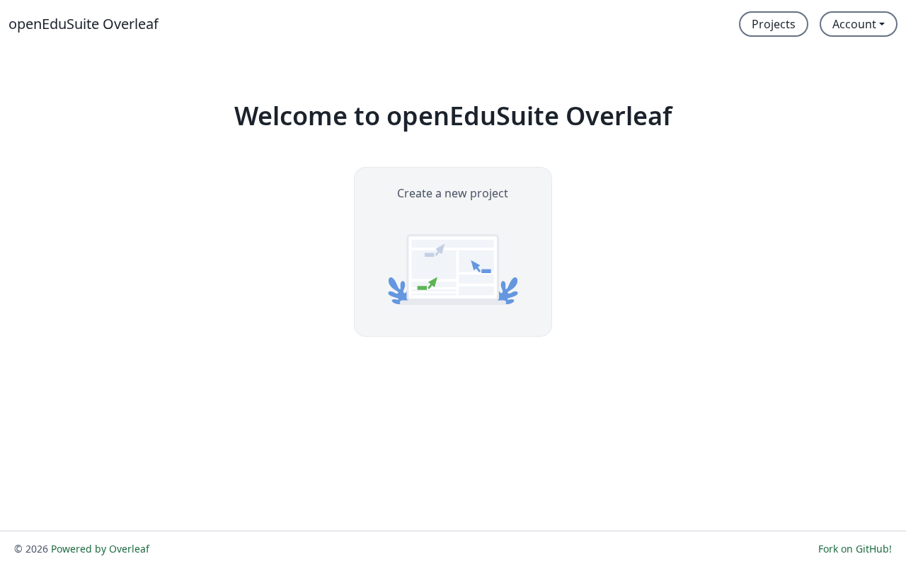

# LaTeX (Overleaf)

[Overleaf](https://overleaf.openedusuite.org) is the LaTeX
workbench of the openEduSuite — write papers, theses, and
reports in LaTeX, compiled live while you type, together in one
project. The portal tile **LaTeX (Overleaf)** and the suite
account open **Projects** directly.

- **Projects** lists your projects; **New Project** starts from
  a template or from scratch.
- In the editor, source and compiled PDF sit side by side; every
  save recompiles — errors show where they are, not three
  paragraphs later.
- The suite instance answers as *openEduSuite Overleaf*; your
  account is the suite account (SSO).

## Overleaf or Typst

- **[Typst](/suite/typst)** — modern markup, instant preview,
  easier start; first choice for most people.
- **Overleaf** — LaTeX: journals, citation styles, and templates
  that already exist in `.tex`. First choice when the target
  venue speaks LaTeX.

## Accessibility

| Action | Key |
|--------|-----|
| Move through project list and menus | `Tab` |
| Open the focused project | `Enter` |

- The project list is a standard list with menus — `Tab` walks
  it, `Enter` opens.
- Overleaf keeps its own comprehensive shortcut list under
  **Help**; `Ctrl+Home` (German keyboards: `Strg+Pos1`) returns
  you to the top of the page.
