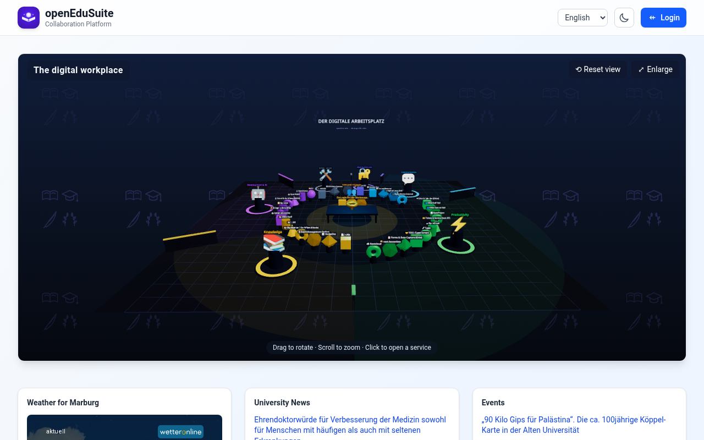

# The Portal

The [portal](https://home.openedusuite.org) is the entry point of the
openEduSuite: your digital workplace. Even before signing in it shows
university news, weather, and events.

## Signing In

Choose **Anmelden** (Login) in the portal and sign in with your
openEduSuite account — the same login that works everywhere in the
suite. See [Signing In](/suite/sso-login) for details.

After signing in, the portal shows your personal digital workplace:
the app tiles, university news and events, and — via **Konto** — the
[account console](/suite/sso-account). **Abmelden** signs you out.

## The App Tiles

The tiles carry the German names of the services. Where we have a
guide, it is linked — the list mirrors the portal as it stands today:

**Communication** — **E-Mail & Kalender (SOGo6)** for mail and
calendars, plus the classic webmail instances
[SOGo (Staff & Students)](/suite/sogo-classic);
[Element Chat](/suite/chat) for messaging; the
[Forum (Discourse)](/suite/discourse) for discussions.

**Files and collaboration** — your files in [OpenCloud](/suite/files)
and [Nextcloud](/suite/nextcloud); wikis with [XWiki](/suite/xwiki)
(and the staff wiki described there); projects and
plans in [OpenProject](/suite/openproject); video rooms in
[BigBlueButton (intern)](/suite/bbb).

**Work and study** — papers with [Typst](/suite/typst) (the writing
studio TOSS lives there too); forms in [Grist](/suite/grist); events on
[Indico](/suite/indico); appointments booked via
[calrs](/suite/calrs); diagrams in [draw.io](/suite/drawio) and sketches
on the [whiteboard](/suite/excalidraw); LaTeX papers in
[Overleaf](/suite/overleaf); courses on the suite's own
[learning platform (ILIAS)](/suite/lms); your [tickets](/suite/helpdesk-create-ticket)
at the Request Tracker; automation with [Operaton](/suite/operaton-tasks)
and [n8n](/suite/n8n); AI in [Open WebUI](/suite/ai-chat) and
[Dify](/suite/dify).

**Research** — scientific workflows in [EWOKS](/suite/ewoks) and
[OpenScience](/suite/openscience), the [F13](/suite/f13) AI text
workbench, digitized collections in the
[library (Kitodo)](/suite/kitodo), and shared notes in
[HedgeDoc](/suite/hedgedoc).

A few tiles lead outside the suite to university services — the
**MARVIN** campus management, the university-wide **ILIAS** learning
platform (the suite's own ILIAS has its own tile above),
**hessenbox** for cloud sync, and the staff directory. Not every tile
is for everyone: what you see depends on your role, and not every
backend is on at every hour — if a service you need stays dark, ask
at the [helpdesk](/suite/helpdesk-create-ticket).

## Accessibility

| Action | Key |
|--------|-----|
| Move through links and tiles | `Tab` |
| Open the focused link or app | `Enter` |

- The portal is built from ordinary links and tiles: `Tab` moves you
  through them in reading order, `Enter` opens the focused element.
  Screenreader users reach the app list under the heading of the
  workplace section.
- If you lose your orientation, press `Ctrl+Home` (German keyboards:
  `Strg+Pos1`) to return to the top of the page.
