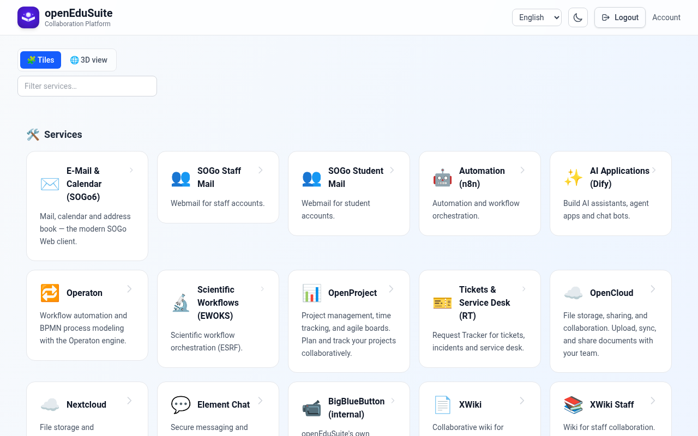

# The Portal

The [portal](https://home.openedusuite.org) is the entry point of the
openEduSuite: your digital workplace. Even before signing in it shows
university news, weather, and events.

## Signing In

Choose **Anmelden** (Login) in the portal and sign in with your
openEduSuite account — the same login that works everywhere in the
suite. See [Signing In](/suite/sso-login) for details.

After signing in, the portal shows your personal digital workplace:

- **App tiles** — one click to your mail and calendar
  (E-Mail & Kalender, SOGo), the [helpdesk](/suite/helpdesk-create-ticket)
  (Tickets & Service Desk), your [files](/suite/files) (OpenCloud), and
  many more services
- **University news and events** — current announcements and dates
- **Your account** — via **Konto** you reach the account console
  (profile, password, two-factor authentication), via **Abmelden**
  (Sign out) you leave the portal

Not every tile is for everyone — what you see depends on your role. If
a service you need is missing, ask at the
[helpdesk](/suite/helpdesk-create-ticket).

## Accessibility

| Action | Key |
|--------|-----|
| Move through links and tiles | `Tab` |
| Open the focused link or app | `Enter` |

- The portal is built from ordinary links and tiles: `Tab` moves you
  through them in reading order, `Enter` opens the focused element.
  Screenreader users reach the app list under the heading of the
  workplace section.
- If you lose your orientation, press `Ctrl+Home` (German keyboards:
  `Strg+Pos1`) to return to the top of the page.
