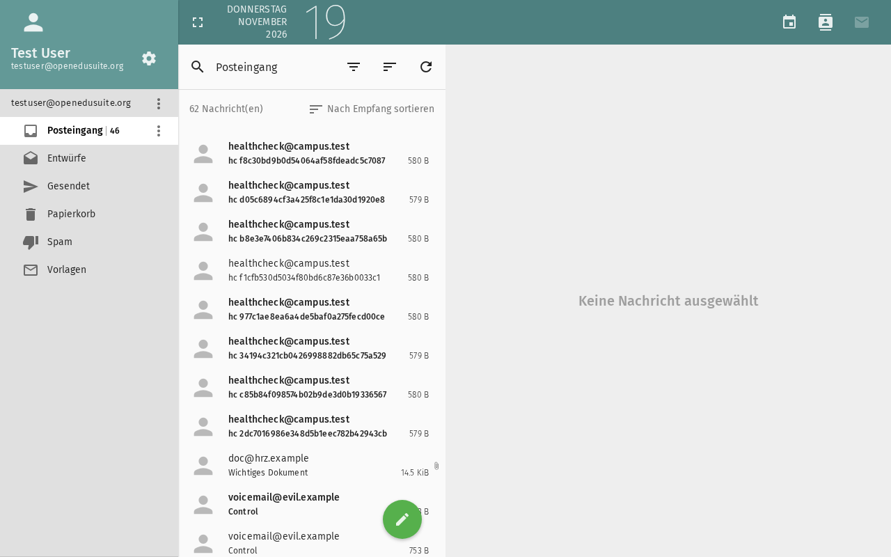

# Mail classic: SOGo (Staff & Students)

Besides the [SOGo6 suite mail](/sogo6/sogo-login), the
openEduSuite runs two **classic SOGo** instances, reachable via
the portal tiles **SOGo Beschäftigten-Post** and
**SOGo Studierenden-Post**. Sign-in runs through SSO — your
account, no second password — and the mailbox opens at the
**Posteingang** (inbox).

- **SOGo Beschäftigten-Post** — the instance for staff
  (Beschäftigte), webmail for staff accounts.
- **SOGo Studierenden-Post** — the instance for students
  (Studierende), webmail for student accounts.

Both open straight to the SOGo 5 interface: mail, calendar, and
address book in the proven layout. The complete tutorials live
under **SOGo 5** in this documentation — every step shown there
applies to both instances:

- [Reading mail](/sogo5/sogo-mail-read) and
  [writing mail](/sogo5/sogo-mail-compose)
- [Calendar views](/sogo5/sogo-calendar-views) and
  [creating events](/sogo5/sogo-calendar-create-event)
- [Address book](/sogo5/sogo-contacts-add)
- [Sign out](/sogo5/sogo-logout)

## Which SOGo You Have

| Instance | Interface | Tutorials |
|----------|-----------|-----------|
| SOGo6 (suite tile **E-Mail & Kalender (SOGo6)**) | The new interface | `/sogo6/…` pages |
| SOGo Beschäftigten-Post / SOGo Studierenden-Post | Classic interface | `/sogo5/…` pages |

If both mailbox and suite mail show the same messages for you,
your account is served on both paths — the tutorials cover each
interface in its own section.

## Accessibility

| Action | Key |
|--------|-----|
| Move through mail list and toolbar | `Tab` |
| Open the focused element | `Enter` |

- Classic SOGo is a web application with menus and lists in
  reading order; `Tab` walks mail list, folders, and toolbar.
- `Ctrl+Home` (German keyboards: `Strg+Pos1`) returns you to the
  top of the page.
