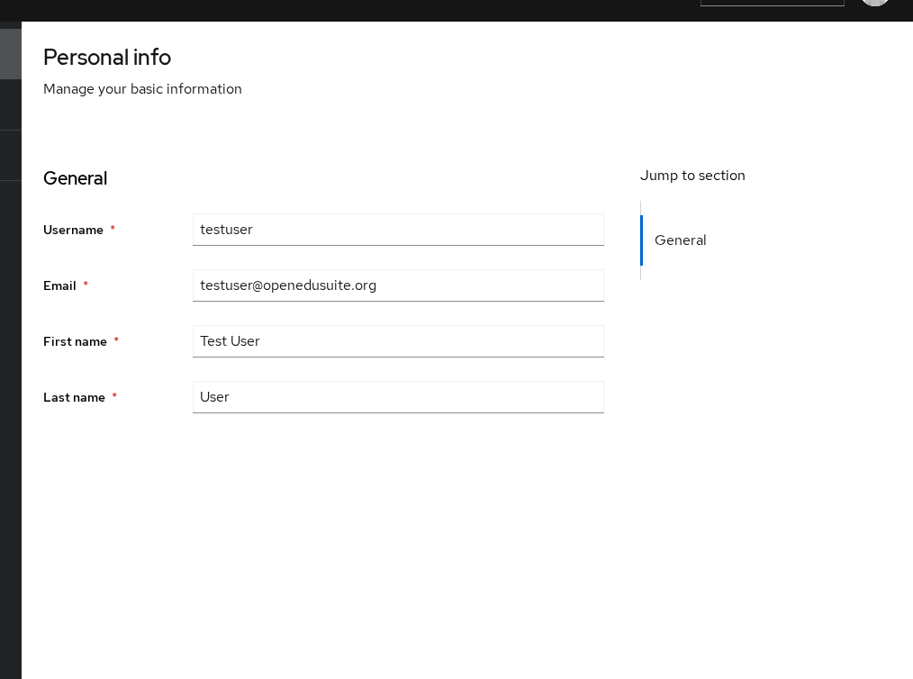
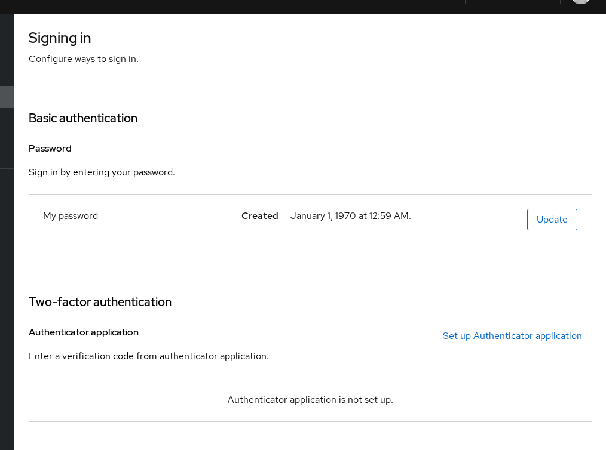
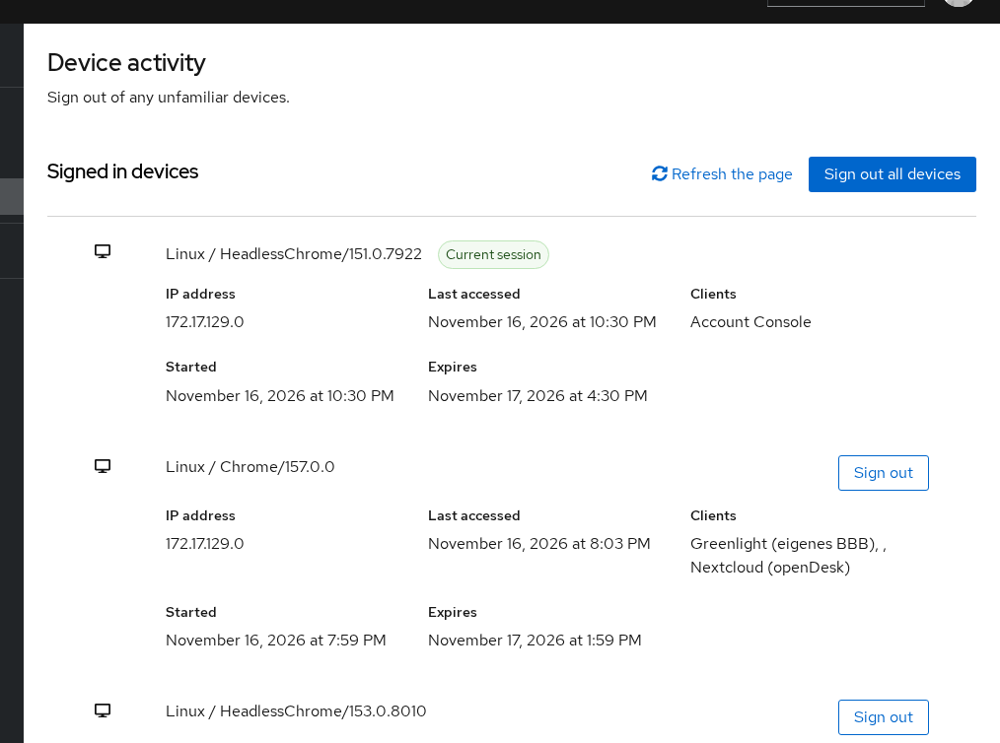

import VideoFallback from '@site/src/components/VideoFallback';

# Your Account

The account console manages everything about your openEduSuite login:
your profile, your password, two-factor authentication, and the devices
you are signed in on.

Open it from any signed-in app, or go to your account page directly and
sign in when asked.

## Personal Info

Shows your account details:

- **Username** and **Email**
- **First name** and **Last name**

<VideoFallback
  srcMp4="/docmakerai/clips/sso-account.mp4"
  poster="/docmakerai/clips/sso-account.png"
  alt="Short clip: the account console showing personal information"
  width="640"
  height="400"
/>

Your username and name are managed by your university; contact your
helpdesk if something is wrong there.

## Signing In

Two sections control how you sign in:

- **Basic authentication**: choose **Update** to change your password
- **Two-factor authentication**: choose
  **Set up Authenticator application** to add a second factor

<VideoFallback
  srcMp4="/docmakerai/clips/sso-signing-in.mp4"
  poster="/docmakerai/clips/sso-signing-in.png"
  alt="Short clip: the Signing in page with password and two-factor options"
  width="640"
  height="400"
/>

Two-factor authentication pairs your login with an authenticator app on
your phone: after entering your password, you also type a code from the
app. We recommend setting it up — it protects your account even if
someone learns your password.

## Device Activity

Lists the devices and browsers where you are signed in. For each entry
you can choose **Sign out** to end that single session, or
**Sign out all devices** to end every session at once.

<VideoFallback
  srcMp4="/docmakerai/clips/sso-devices.mp4"
  poster="/docmakerai/clips/sso-devices.png"
  alt="Short clip: the Device activity page listing signed-in devices"
  width="640"
  height="400"
/>

Use it when you finish working on a shared computer, or when you want to
be safe after using a device you do not control.

## Accessibility

| Action | Key |
|--------|-----|
| Move through form fields and buttons | `Tab` |
| Activate a button or save a change | `Enter` |

- The account pages are ordinary forms and lists: `Tab` moves through
  them in order, `Enter` activates the focused button. Screen readers
  announce the field labels and headings ("Personal info", "Signing in")
  as you move.
- If you lose your place, press `Ctrl+Home` (German keyboards:
  `Strg+Pos1`) to return to the top of the page, then use `Tab` to
  proceed from there.
