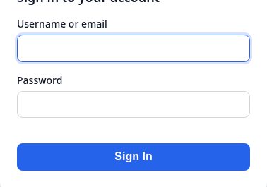

import VideoFallback from '@site/src/components/VideoFallback';

# Signing In: One Login for All Apps

The openEduSuite apps — mail, files, wiki, helpdesk and more — share one
login. You sign in once with your university account, and every app
recognizes you afterwards.

## How Signing In Works

1. Open an openEduSuite app, or open your university's portal
2. You are forwarded to the **openEduSuite login screen**
3. Enter your **Username or email** and your **Password**
4. Choose **Sign In**
5. You are returned to the app — signed in

<VideoFallback
  srcMp4="/docmakerai/clips/sso-login.mp4"
  poster="/docmakerai/clips/sso-login.png"
  alt="Short clip: the openEduSuite login screen"
  width="640"
  height="400"
/>

The same login screen appears for every app. Signing in to a second app
usually happens automatically, without asking again.

## Managing Your Account

After signing in, you can review and change your account details — name,
password, two-factor authentication, and where you are signed in — in the
account console. See [Your Account](/suite/sso-account).

## Signing Out

- In most apps, sign out from the app's user menu
- To end your session everywhere, use
  [Sign out all devices](/suite/sso-account#device-activity) in the account
  console

## Accessibility

| Action | Key |
|--------|-----|
| Move between fields | `Tab` |
| Sign in | `Enter` |

- The login form is a standard form: `Tab` moves from field to field, and
  `Enter` submits it. Screen readers announce the field labels
  ("Username or email", "Password") when you move into them.
- If you are unsure where you are on the page, press `Ctrl+Home`
  (German keyboards: `Strg+Pos1`) to jump to the top, then use `Tab` to
  reach the form.

- **High contrast and dark mode:** contrast and dark themes come from the
  operating system or browser — Windows `Win+Ctrl+C`, macOS *Increase contrast*,
  or a browser extension such as Dark Reader. If the app offers its own dark
  theme, switch it in its settings; the navigation described above still applies.
