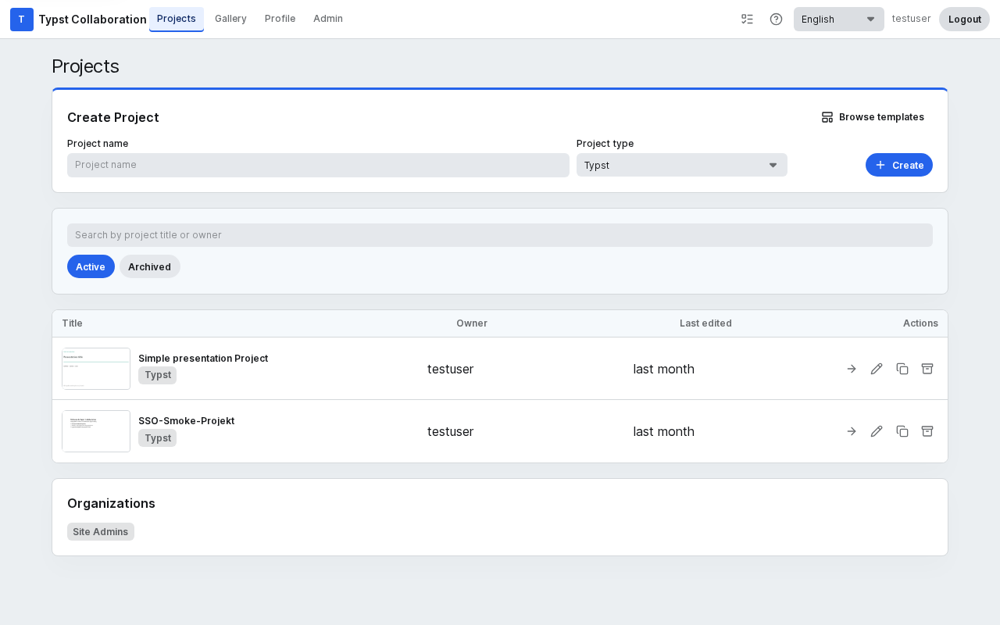

# Writing Papers (Typst)

The openEduSuite's [writing studio](https://toss.openedusuite.org) is
built around [Typst](https://typst.app) — the modern typesetting
engine that turns plain text into polished PDFs, without LaTeX's
steep edges. In the browser you write, the preview builds itself
live, and the PDF export is one click.

## Signing In

Sign in with your openEduSuite account — single sign-on takes you
straight to your **Projects** page. It lists your papers with
owner and last-edited date, each with **Open**, **Rename**,
**Copy**, and **Archive** actions, and switches between **Active**
and **Archived**. The navigation offers **Gallery**, **Profile**,
and **Tasks** alongside, plus **Help** — a help center with guides
on getting started, editing and preview, packages, and LaTeX
projects.

## Starting a Paper

**Create Project** opens the small form: give your paper a
**Project name**, pick **Typst** as the project type (LaTeX sits
next to it), and **Create** opens the editor. **Browse templates**
leads to the gallery of maintained starting points. The editor
carries the tabs **View**, **Files**, **Preview**, **Settings**,
and **Revisions**; source text on one side, the rendered preview
on the other. Typst's markup is lighter than LaTeX: `=`
headings, `-` lists, `$…$` math. When the paper is ready, the
preview panel's **Download PDF** button exports it.

## Why Typst

- **Fast feedback** — the preview follows your typing, not a compiler
- **Gentle syntax** — readable source that still typesets tables,
  figures, math, and bibliographies
- **In the browser** — nothing to install; your projects wait in
  the studio wherever you sign in

For longer documents that outgrow a chat or the [wiki](/suite/xwiki),
the studio is the place — and finished PDFs fit right into your
[cloud files](/suite/files).

## Accessibility

| Action | Key |
|--------|-----|
| Move through projects and forms | `Tab` |
| Confirm the focused form control | `Enter` |

- The pages are ordinary web elements: `Tab` moves you through the
  project list and the create form, `Enter` confirms.
- In the editor, `Escape` closes overlays and dialogs; if you lose
  your orientation, `Ctrl+Home` (German keyboards: `Strg+Pos1`)
  returns you to the top of the page.
