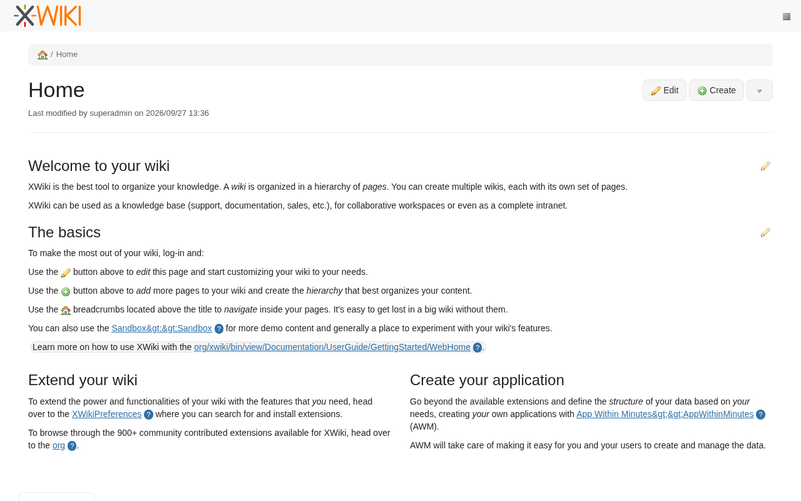

# Wiki (XWiki)

The openEduSuite [wiki](https://xwiki.openedusuite.org) is the shared
knowledge base: documentation, how-tos, and course material that
belongs together — written by everyone, for everyone. It runs on
[XWiki](https://www.xwiki.org), one of the longest-lived open wiki
engines.

## Reading and Signing In

The wiki is openly readable — no account is needed to browse. In the
top bar, **Log-in** sits next to **Register** — reached from the
[portal](/suite/portal) tile. Choose **Log-in**: you
are passed to the openEduSuite sign-in, and back into the wiki with
your name attached to what you change.

## The Main Page

The wiki's main page is its front door: a **Welcome to your wiki**
heading with the first sections — **The basics**, **Extend your wiki**
and **Create your application** — and pointers to extend the wiki.
**The basics** tells you to log in and then use the **Edit** button
above this page, the **Create** button above to add more pages, and
the breadcrumbs above the title to navigate. It also points to a
**Sandbox** — a place meant for experimenting with the wiki's
features. The action bar keeps **Edit**, **Create** and
**More Actions** ready.

## Writing Together

A wiki grows by small steps: click **Edit**, improve what is there,
and save with a short note in the **Version summary** field on what
changed. **Create** starts a new page. Want to practice first? The
main page's **The basics** section points to the **Sandbox** as a
place to experiment.

Every change is kept: open **More Actions** and choose **History** —
it lists all revisions of a page, with **Rollback** available. The
same menu groups **Copy** under Manage, **Export** and
**Print Preview** under Actions, and **Source**, **Children**, **Comments**,
**Attachments** and **Information** under Viewers. For team material
that changes often, the wiki beats file attachments — and it links
naturally with your [projects](/suite/openproject) and conversations
in the [chat](/suite/chat).

## The Staff Wiki

Next to the main wiki there is a second instance for staff material:
[xwiki-staff.openedusuite.org](https://xwiki-staff.openedusuite.org). It
works the same way: openly readable, and **Log-in** passes you to the
openEduSuite sign-in with your suite account.

Use the staff wiki for internal staff material, and the main wiki for
content that is meant for everyone.

## Accessibility

| Action | Key |
|--------|-----|
| Move through navigation and page content | `Tab` |
| Open the focused link | `Enter` |
| Leave the editor's dialog menus | `Escape` |

- The wiki is an ordinary web application: `Tab` moves you through
  navigation, content, and the edit actions, `Enter` follows the
  focused link.
- If you lose your orientation, `Ctrl+Home` (German keyboards:
  `Strg+Pos1`) returns you to the top of the page.
