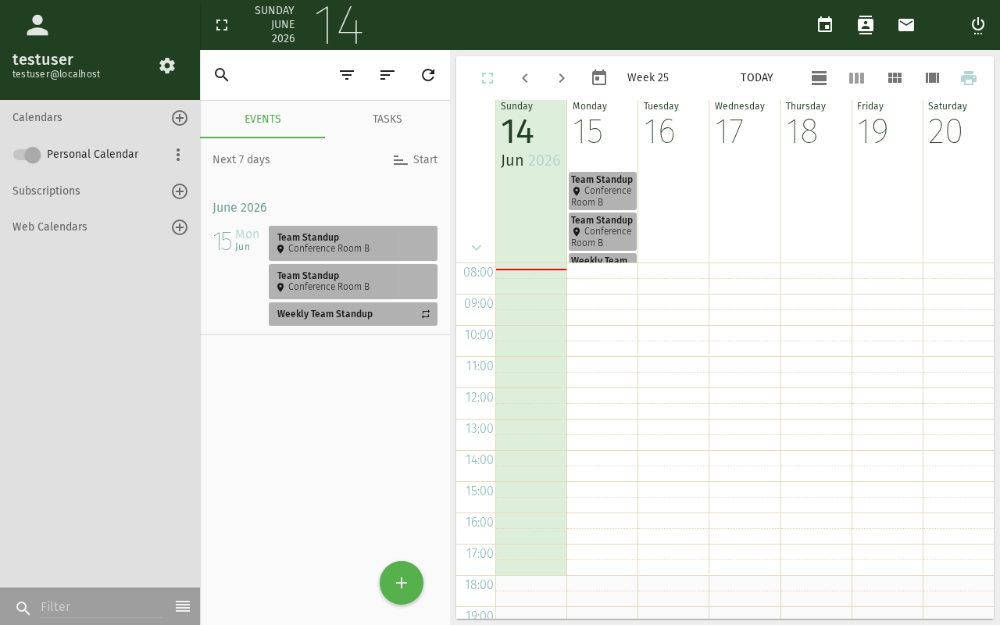
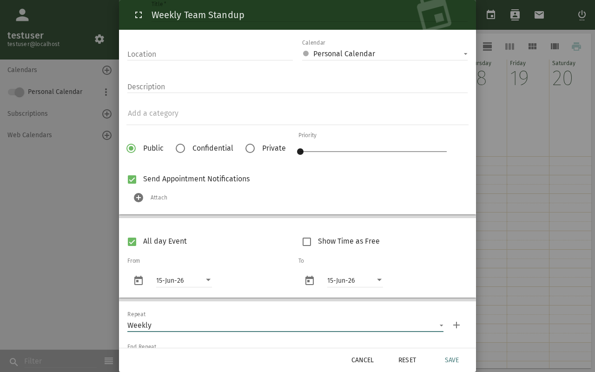
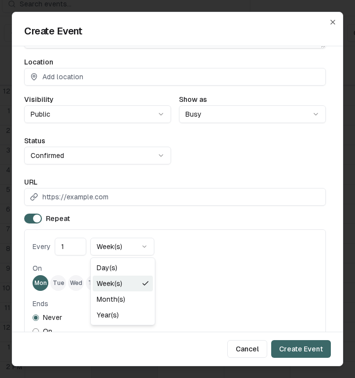
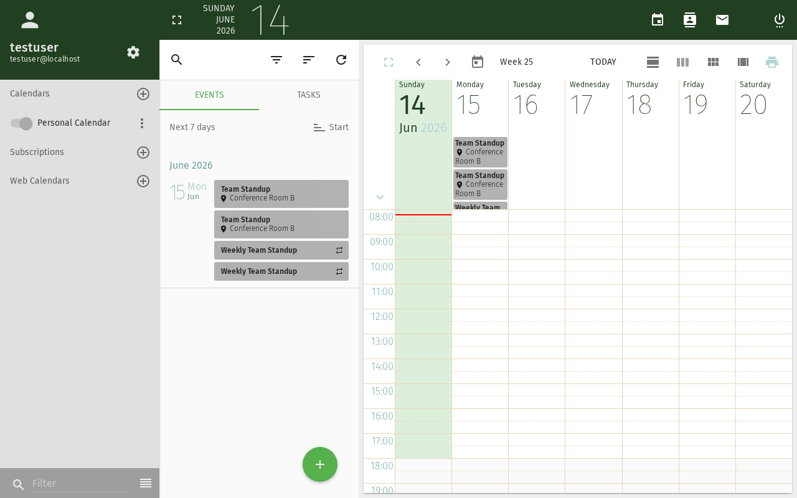

import Tabs from '@theme/Tabs';
import TabItem from '@theme/TabItem';
import PageSEO from '@site/src/components/PageSEO';
import VideoFallback from '@site/src/components/VideoFallback';

<PageSEO title="Recurring Events & Alarms" description="Step-by-step tutorial to set up repeating events with email and display reminders in SOGo 6" keywords={["recurring events", "alarms", "reminders", "repeating", "notifications"]} />

# Recurring Events & Alarms

This tutorial covers creating events that repeat on a schedule and
configuring reminders so you never miss them.

## Prerequisites

- A SOGo 6 account with valid credentials
- You are logged into SOGo 6

## Part 1: Creating a Recurring Event

### Step 1: Start a New Event

1. Open the **Calendar** module
2. Click the **+** (plus) button or double-click a time slot

3. The new event dialog appears

### Step 2: Set Basic Details

Fill in:
- **Title:** e.g., "Weekly Team Standup"
- **Start / End:** First occurrence date and time
- **Calendar:** Choose which calendar to save to

### Step 3: Configure Recurrence

Toggle **Repeat** on:

| Option | Description | Example Use |
|:-------|:------------|:-------------|
| **Day(s)** | Repeats every N days | Morning check-in |
| **Week(s)** | Repeats on selected weekdays | Standup every Mon/Wed/Fri |
| **Month(s)** | Repeats on a day of the month | Department meeting on 1st |
| **Year(s)** | Repeats on a date each year | Birthday, anniversary |

<VideoFallback
  srcMp4="/docmakerai/clips/calendar-recurring.mp4"
  poster="/docmakerai/clips/calendar-recurring.png"
  alt="Short clip: enabling Repeat and opening the frequency options in the SOGo 6 event dialog"
  width="640"
  height="400"
/>

### Step 4: Set an End Date (Recommended)

Always set an end date for recurring events to prevent infinite
repetition:

- **End by date:** Choose a specific date (e.g., end of semester)
- **End after N occurrences:** Limit the number of repetitions
- **No end date:** Use sparingly — only for permanent events

### Step 5: Create the Recurring Event

Click **Create Event**. The event is created and marked as recurring
indicating it repeats.

## Part 2: Adding Alarms (Reminders)

To receive a reminder before the event:

1. In the event dialog, click **Add reminder**
2. Set how far in advance you want to be reminded

You can add more than one reminder per event.

## Part 3: Editing or Stopping Recurrence

### Edit a Single Occurrence

1. Click on the specific event instance in the calendar
2. Choose **Edit this occurrence only**
3. Make changes — they apply only to that date

### Edit the Entire Series

1. Click on any occurrence
2. Choose **Edit the series**
3. Changes apply to all events in the recurrence

### Stop Recurrence

1. Open the event dialog
2. Set **Repeat** to **None**
3. Save — SOGo 6 asks if you want to keep existing future events
4. Choose **Delete all future events** or **Keep them as individual events**

## Troubleshooting

### Recurrence options not showing

- Make sure you're editing a new or existing event in the **Calendar**
  module, not an invitation received via email

### Alarm not firing

- **Display alarms** require the browser tab to be open
- Check your browser's notification permissions

## Conclusion

You have learned to create recurring events and set up alarms in SOGo 6.
These features are essential for regular meetings, deadlines, and
important dates.

## Accessibility

### Keyboard Navigation

SOGo 6 supports full keyboard navigation for recurring events.

| Action | Keyboard Shortcut | Notes |
|--------|--------------------------------------|------------------------------|
| Navigate to Calendar | `Tab` to Calendars, then `Enter` |
| Create new event | `N` or `+` |
| Open recurrence settings | `Tab` to the recurrence field |
| Set frequency | Arrow keys (Daily/Weekly/Monthly/Yearly) |
| Set recurrence end | Tab to end fields |
| Set interval | Arrow key + Tab |
| Create the recurring event | `Tab` to **Create Event**, then `Enter` |

### Screen Reader Workflow

**Creating Recurring Event**

**Step 1: Create New Event**
1. `Tab` to reach the sidebar
2. Arrow keys to "Calendar"
3. Press `N` or `+` for new event

**Step 2: Open Recurrence Settings**
1. Event dialog opens
2. Tab to the recurrence field
3. Press `Space` to expand recurrence section

**Step 3: Set Recurrence Frequency**
1. Focus on frequency dropdown
2. Arrow key to select (Daily/Weekly/Monthly/Yearly)
3. Press `Enter`

**Step 4: Set Recurrence Details**
1. Tab to interval field (e.g., "Every 2 days")
2. Type interval number, arrow to select unit
3. Tab to end date/occurrence count
4. Specify when recurrence should end

**Step 5: Create Recurring Event**
1. Tab to the "Create Event" button
2. Press `Enter`
3. You should hear a confirmation that the series was created

**Common Screen Reader Announcements:**

| Announcement | Meaning | Action |
|--------------------------------------|------------------------|-------------------|
| "Recurrence, check box" | Recurrence available | Press Space to enable |
| "Frequency, radio button" | How often to repeat | Arrow to select type |
| "Every, edit" | Recurrence interval | Type number, select unit |
| "Until, date picker" | When to end recurrence | Tab, select end date |
| "Occurrences, edit" | How many times to repeat | Type number or leave blank |
| "Recurring event created" | Success | Event series saved |

### Visual Content Descriptions

**calendar-recurring.png:** Static screenshot of the event dialog with the recurrence frequency dropdown open.

### High Contrast Mode

SOGo 6's dark mode and high contrast mode work with all sections described above. Toggle via: three-dot menu (⋯) → General → Theme → Dark/High Contrast.
