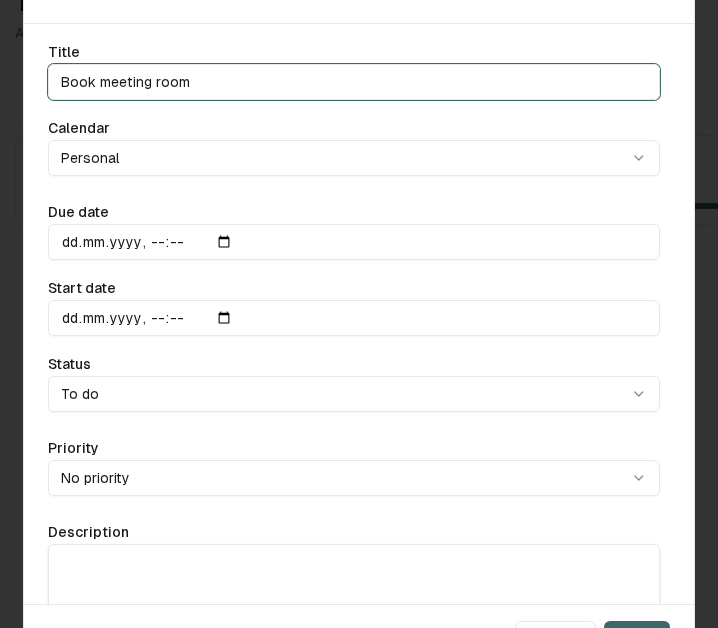

import PageSEO from '@site/src/components/PageSEO';
import VideoFallback from '@site/src/components/VideoFallback';

<PageSEO title="Tasks / To-Do Module" description="Step-by-step tutorial for the SOGo 6 task module: create tasks, set status, priority and due dates" keywords={["tasks", "todo", "task management", "priorities", "productivity"]} />

# Tasks / To-Do Module

Organize tasks, set priorities and due dates in the SOGo 6 task module.

## Prerequisites

- A SOGo 6 account with valid credentials
- You are logged into SOGo 6

## The Module at a Glance

In the navigation sidebar, click **Tasks** to enter the module.

Tasks are grouped into views along the top of the module:

| View | Shows |
|------|-------|
| **All tasks** | Every task |
| **Today** | Tasks due today |
| **Upcoming** | Tasks due later |
| **Overdue** | Tasks past their due date |
| **Completed** | Finished tasks |

Tasks are saved to a calendar — by default your personal calendar.

## Create a Task

1. Click **New task**
2. Fill in the dialog:

| Field | Description |
|-------|-------------|
| **Title** | Short task name |
| **Calendar** | Which calendar to save the task to |
| **Due date** | When the task must be completed |
| **Start date** | When the task starts |
| **Status** | Task status — default: *To do* |
| **Priority** | Task priority — default: *No priority* |
| **Description** | Detailed notes |

3. Click **Save**

<VideoFallback
  srcMp4="/docmakerai/clips/tasks-add.mp4"
  poster="/docmakerai/clips/tasks-add.png"
  alt="Short clip: opening the New task dialog and filling in the title in SOGo 6"
  width="640"
  height="400"
/>

## Work with Tasks

- Open a task to edit any of its fields
- The **Completed** view collects finished tasks
- The **Overdue** view shows tasks that passed their due date

## Accessibility

### Keyboard Navigation

| Action | How | Notes |
|--------|-----|-------|
| Open Tasks module | `Tab` to Tasks, then `Enter` | From any module |
| Create a task | `Tab` to **New task**, then `Enter` | Opens the task dialog |
| Move through dialog fields | `Tab` / `Shift+Tab` | Arrow keys work inside dropdowns |
| Save the task | `Tab` to **Save**, then `Enter` | Confirm button of the dialog |

### Screen Readers

- `Strg+Pos1` / `Ctrl+Home` takes you to the top of the page — a reliable
  starting point for exploring with `h` (headings) in your screen reader.
- After opening the task dialog, `Tab` reaches the fields in their visual
  order: Title, Calendar, Due date, Start date, Status, Priority,
  Description.
- You should hear the field labels as you move through them.

- **High contrast and dark mode:** contrast and dark themes come from the
  operating system or browser — Windows `Win+Ctrl+C`, macOS *Increase contrast*,
  or a browser extension such as Dark Reader. If the app offers its own dark
  theme, switch it in its settings; the navigation described above still applies.
